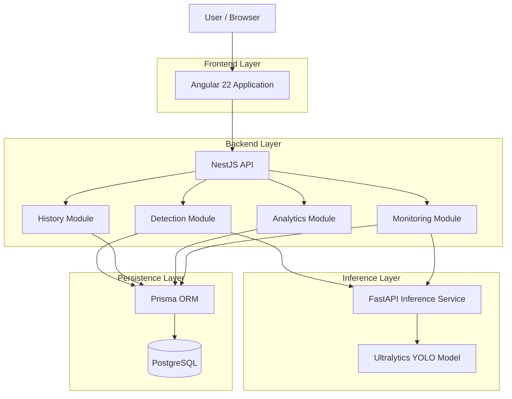

# Image Detection System

A full-stack computer vision application for image-based object detection, detection history, analytics, and machine-learning model monitoring.

The application uses **Ultralytics YOLO** for object detection, **FastAPI** for model inference, **NestJS** for backend APIs, **PostgreSQL** for persistent storage, and **Angular** for the frontend.

The system is containerized with Docker Compose and designed with a modular architecture that separates frontend, API, inference, and database responsibilities.

---

## Table of Contents

- [Overview](#overview)
- [Features](#features)
- [Architecture](#architecture)
- [Technology Stack](#technology-stack)
- [Project Structure](#project-structure)
- [Getting Started](#getting-started)
- [Docker Setup](#docker-setup)
- [Application Services](#application-services)
- [Object Detection Workflow](#object-detection-workflow)
- [Inference Monitoring](#inference-monitoring)
- [Database and Persistence](#database-and-persistence)
- [API Documentation](#api-documentation)
- [Testing](#testing)
- [Development Guidelines](#development-guidelines)
- [Future Improvements](#future-improvements)
- [Project Status](#project-status)
- [License](#license)

---

## Overview

The Image Detection System provides an end-to-end workflow for uploading images, detecting objects, reviewing detection results, analyzing detection statistics, and monitoring inference performance.

The application separates responsibilities into independent services:

1. **Angular Frontend** – User interface for image uploads, detection results, history, analytics, and monitoring.
2. **NestJS API** – Application backend responsible for request handling, detection orchestration, persistence, and analytics.
3. **FastAPI Inference Service** – Executes YOLO-based object detection.
4. **PostgreSQL** – Stores detection records and persistent inference metrics.
5. **Prisma ORM** – Provides database access and schema/migration management.

The services communicate through internal Docker networking, keeping the inference engine and database separate from the public-facing application layer.

---

## Features

### 1. Image Object Detection

- Upload images for object detection.
- Execute inference using Ultralytics YOLO.
- Retrieve detected object classes and confidence scores.
- Generate bounding-box coordinates.
- Display detection results visually over the original image.
- Filter detections by confidence threshold.
- Toggle individual object classes.
- Manage image previews and detection annotations.

### 2. Detection History

- Persist detection results in PostgreSQL.
- Browse previously processed images.
- View detection details.
- Filter historical records.
- Support paginated history retrieval.
- Retrieve original uploaded images.
- Inspect individual detection bounding boxes and confidence scores.

### 3. Analytics Dashboard

- View aggregated detection statistics.
- Analyze detection activity.
- Retrieve analytics through dedicated backend APIs.
- Display analytical information through the Angular dashboard.

### 4. Model Monitoring

Monitor the health and performance of the application and inference infrastructure.

#### Live Monitoring

- Backend API availability.
- PostgreSQL connectivity.
- Inference service availability.
- Model loading status.
- Model configuration.
- Live inference attempts.
- Successful and failed inference counts.
- Inference latency statistics.
- Success and failure distribution.
- Automatic refresh every 30 seconds.
- Manual refresh.

#### Historical Monitoring

- Persistent inference metrics.
- Total inference attempts.
- Successful and failed inference counts.
- Success and failure rates.
- Average processing time.
- Average request duration.
- P95 request duration.
- Historical inference trends.
- Model performance statistics.
- Error distribution.
- Recent inference activity.

Historical metrics can be queried using three time ranges:

- `24h` – Last 24 hours.
- `7d` – Last 7 days.
- `30d` – Last 30 days.

---

## Architecture

The application follows a service-oriented architecture.



### Service Responsibilities

| Service | Responsibility |
|---|---|
| Angular | User interface and application interactions |
| NestJS | API, orchestration, business logic, and persistence |
| FastAPI | Model loading and image inference |
| YOLO | Object detection |
| PostgreSQL | Persistent application data and metrics |
| Prisma | Database access and migrations |

### Architectural Decisions

- Keep model inference independent of the main API.
- Use NestJS as the primary application backend.
- Use FastAPI specifically for Python-based ML inference.
- Store historical inference metrics in PostgreSQL.
- Keep live inference metrics in the inference service's in-memory monitoring system.
- Ensure monitoring persistence failures do not interrupt the primary detection workflow.
- Use Docker Compose for service orchestration.

---

## Technology Stack

| Category | Technologies |
|---|---|
| Frontend | Angular 22, TypeScript, SCSS |
| Backend | Node.js, NestJS, TypeScript |
| ML Inference | Python, FastAPI |
| Object Detection | Ultralytics YOLO |
| Computer Vision | OpenCV |
| Database | PostgreSQL 17 |
| ORM | Prisma 7 |
| API Communication | HTTP / REST |
| Containerization | Docker, Docker Compose |
| Testing | Vitest, Angular testing utilities, Jest |
| Package Management | pnpm, Yarn, Python pip |

---

## Project Structure

The repository is organized into separate application directories.

```text
image-detection-system/
│
├── apps/
│   ├── frontend/
│   │   ├── src/
│   │   │   └── app/
│   │   │       ├── core/
│   │   │       │   ├── config/
│   │   │       │   └── services/
│   │   │       ├── shared/
│   │   │       │   └── models/
│   │   │       └── features/
│   │   │           ├── workspace/
│   │   │           ├── history/
│   │   │           ├── history-detail/
│   │   │           ├── analytics/
│   │   │           └── monitoring/
│   │   ├── public/
│   │   ├── angular.json
│   │   └── package.json
│   │
│   └── api/
│       ├── prisma/
│       │   └── migrations/
│       ├── src/
│       │   ├── detection/
│       │   ├── history/
│       │   ├── analytics/
│       │   ├── monitoring/
│       │   ├── health/
│       │   └── generated/
│       └── package.json
│
├── inference/
│   └── app/
│       └── ...
│
├── data/
│   ├── images/
│   └── ...
│
├── runs/
│   ├── detect/
│   └── train/
│
├── docker-compose.yml
├── .env.example
└── README.md
```

> **Note:** The structure above represents the main application areas. Individual files and additional directories may vary as the project evolves.

---

## Getting Started

### Prerequisites

Install the following tools:

- Git
- Docker Engine
- Docker Compose
- Node.js
- pnpm
- Python 3.12+
- pip

For local ML development, a CPU-based environment is supported. GPU acceleration is not required for the current CPU inference workflow.

### 1. Clone the Repository

```bash
git clone <YOUR_REPOSITORY_URL>

cd image-detection-system
```

### 2. Configure Environment Variables

Create your local environment file using the repository's environment template.

```bash
cp .env.example .env
```

Update the configuration values according to your environment.

Important configuration categories include:

- PostgreSQL connection details.
- API port and environment.
- Inference service URL.
- Model configuration.
- Frontend API configuration.

> **Important:** Do not commit `.env` files, database credentials, API secrets, or model credentials.

### 3. Start the Application with Docker Compose

Build and start the application services:

```bash
docker compose up --build -d
```

Check the service status:

```bash
docker compose ps
```

View service logs:

```bash
docker compose logs -f
```

View individual service logs:

```bash
docker compose logs -f api
docker compose logs -f inference
docker compose logs -f postgres
```

Stop the application:

```bash
docker compose down
```

> **Important:** Avoid `docker compose down -v` unless you explicitly intend to delete persistent Docker volumes and database data.

---

## Docker Setup

The Docker Compose environment includes the following services:

| Service | Responsibility |
|---|---|
| `postgres` | PostgreSQL database |
| `migrate` | Prisma database migrations |
| `inference` | FastAPI and YOLO inference |
| `api` | NestJS application backend |

### Service Communication

The API communicates with the inference service through the internal Docker network.

The configured inference URL is:

```env
INFERENCE_BASE_URL=http://inference:8000
```

The database is accessed using its Docker service hostname rather than `localhost` from inside application containers.

For example:

```text
postgres:5432
```

### Database Migrations

Database migrations are managed through Prisma.

Run migrations using the configured migration container:

```bash
docker compose run --rm migrate yarn prisma migrate dev
```

For production deployments, use the appropriate migration deployment command configured by the project.

> Never run the container-internal database URL directly from the host machine unless the database is explicitly configured to expose a host-accessible port.

---

## Application Services

### Frontend

The frontend is an Angular standalone-component application.

Main feature areas:

- **Workspace** – Image upload and detection.
- **History** – Previously processed images.
- **History Detail** – Individual detection information.
- **Analytics** – Aggregated detection insights.
- **Monitoring** – Live and historical model monitoring.

To run the frontend locally, use the package manager and scripts defined in `apps/frontend/package.json`.

### Backend API

The NestJS backend handles:

- Detection requests.
- Inference orchestration.
- Detection persistence.
- Historical queries.
- Analytics aggregation.
- Model monitoring.
- Health checks.

The API uses the global prefix:

```text
/api/v1
```

The readiness endpoint is:

```http
GET /api/v1/health/ready
```

### Inference Service

The FastAPI service is responsible for:

- Loading the YOLO model.
- Receiving image inference requests.
- Executing model predictions.
- Returning detection results.
- Maintaining live inference metrics.

The inference service uses port `8000` inside the Docker network.

---

## Object Detection Workflow

The detection workflow follows these steps:

1. The user uploads an image through the Angular frontend.
2. Angular sends the image to the NestJS API.
3. NestJS validates and processes the request.
4. NestJS forwards the image to the FastAPI inference service.
5. FastAPI executes YOLO inference.
6. The inference service returns detection information.
7. NestJS records inference metrics.
8. Detection results are persisted in PostgreSQL.
9. The API returns the response to Angular.
10. Angular renders bounding boxes, labels, and confidence scores.

### Detection and Inference Metrics

The application distinguishes between two timing measurements:

| Metric | Meaning |
|---|---|
| `processingTimeMs` | Actual model processing time |
| `requestDurationMs` | Total inference request duration measured by NestJS |

These measurements are intentionally separate because model execution time and service round-trip time represent different performance characteristics.

---

## Inference Monitoring

The monitoring system has two distinct data sources.

### Live Metrics

Live metrics are maintained in memory by the FastAPI inference service.

They provide current runtime information such as:

- Total inference attempts.
- Successful inference count.
- Failed inference count.
- Average latency.
- Minimum and maximum latency.
- Last inference latency.
- Last inference timestamp.
- Inference service uptime.

> These metrics are runtime-dependent and reset when the inference process restarts.

### Historical Metrics

Historical metrics are persisted in PostgreSQL through the `InferenceMetric` model.

The model stores:

| Field | Description |
|---|---|
| `id` | Unique metric identifier |
| `status` | `SUCCESS` or `FAILED` |
| `modelName` | Model used for inference |
| `processingTimeMs` | Model execution duration |
| `requestDurationMs` | Total request duration |
| `httpStatus` | Relevant HTTP status |
| `errorCode` | Sanitized error classification |
| `createdAt` | Metric creation timestamp |

The database uses indexes on creation time, status with creation time, and model name with creation time to support historical queries.

### Failure Handling

Monitoring persistence is designed not to interfere with the main detection workflow.

- Invalid uploads rejected before inference are not counted as inference attempts.
- Inference network failures and invalid responses are recorded as failed attempts.
- Successful inference remains successful even if later detection persistence fails.
- Failure to persist a monitoring metric must not fail the detection request.
- Raw exception details, image contents, filenames, and sensitive user data are not stored in the monitoring metric.

---

## Database and Persistence

PostgreSQL is the primary persistence layer.

Prisma manages the database schema, generated client, and migrations.

The application persists:

- Detection records.
- Detection results.
- Associated object information.
- Historical inference metrics.

Database schema changes should be introduced through Prisma migrations.

Avoid manually modifying production database tables without a corresponding migration.

---

## API Documentation

The backend API uses the `/api/v1` global prefix.

Important API capabilities include:

| Module | Responsibility |
|---|---|
| Health | Application readiness |
| Detection | Image inference and result processing |
| History | Detection history and details |
| Analytics | Aggregated detection statistics |
| Monitoring | Live and historical inference monitoring |

### Monitoring Endpoint

The monitoring overview endpoint is:

```http
GET /api/v1/monitoring/overview
```

Supported query parameters:

```text
range=24h
range=7d
range=30d
```

Example:

```http
GET /api/v1/monitoring/overview?range=7d
```

The response includes:

- API health.
- Database health.
- Inference service health.
- Model configuration.
- Live inference metrics.
- Historical summary.
- Historical trends.
- Model performance.
- Error distribution.
- Recent inference activity.

The response uses a success envelope containing the monitoring data.

---

## Testing

The project includes frontend and backend tests.

### Frontend

Run commands from `apps/frontend`.

**Build the application:**

```bash
npx ng build
```

**Run tests:**

```bash
npx ng test
```

**Run TypeScript checks:**

```bash
npx tsc --noEmit
```

**Run ESLint:**

```bash
npx ng lint
```

### Backend

Run the backend tests and build using the scripts configured in `apps/api/package.json`.

The backend has dedicated tests for:

- Detection processing.
- Inference metric recording.
- Monitoring service behavior.
- Partial service availability.
- Historical metric aggregation.
- Error handling.

### Inference Service

Run the Python test suite using the project's configured test environment and dependencies.

---

## Development Guidelines

### Code Organization

- Keep frontend components focused on presentation and interaction.
- Keep backend business logic inside dedicated NestJS modules and services.
- Keep Python-specific ML operations inside the inference service.
- Keep database access and schema changes managed through Prisma.
- Avoid duplicating monitoring or analytics responsibilities across services.

### Error Handling

- Validate incoming image requests before starting inference.
- Handle inference timeouts and network failures.
- Keep service health independent where possible.
- Avoid exposing raw exceptions or sensitive implementation details to API clients.
- Ensure monitoring failures do not break detection functionality.

### Git Workflow

Use feature branches for individual development tasks.

**Create a feature branch:**

```bash
git checkout -b feature/your-feature-name
```

**Commit changes with descriptive messages:**

```bash
git add .
git commit -m "feat: describe your feature"
```

**Push the branch:**

```bash
git push origin feature/your-feature-name
```

---

## Future Improvements

Potential future development areas include:

### Machine Learning

- Model version management.
- Model comparison.
- Confidence distribution analysis.
- Class-wise detection statistics.
- Model drift detection.
- Model evaluation and benchmarking.

### Monitoring and Observability

- Advanced latency percentiles.
- Inference throughput tracking.
- Model-specific performance comparisons.
- Configurable alerts.
- Monitoring dashboards with richer visualizations.
- Long-term performance analysis.

### Infrastructure

- Improved deployment automation.
- Centralized structured logging.
- Production alerting.
- Resource utilization monitoring.
- Scaling and performance optimization.

---

## Project Status

The project currently includes:

- YOLO-based object detection.
- Angular application frontend.
- NestJS backend API.
- FastAPI inference service.
- PostgreSQL persistence.
- Detection history and analytics.
- Live model monitoring.
- Persistent historical inference metrics.
- Docker Compose orchestration.

The historical monitoring implementation has passed the current frontend production build, **69 frontend tests**, TypeScript checks, and the existing backend verification suite.

The complete end-to-end Docker monitoring workflow and remaining frontend lint cleanup are still part of the verification work.

---

## License

Add the project's chosen license and ownership information before publishing or distributing this repository.

---

**Note:** Keep this README updated whenever the architecture, environment configuration, service endpoints, or development commands change.